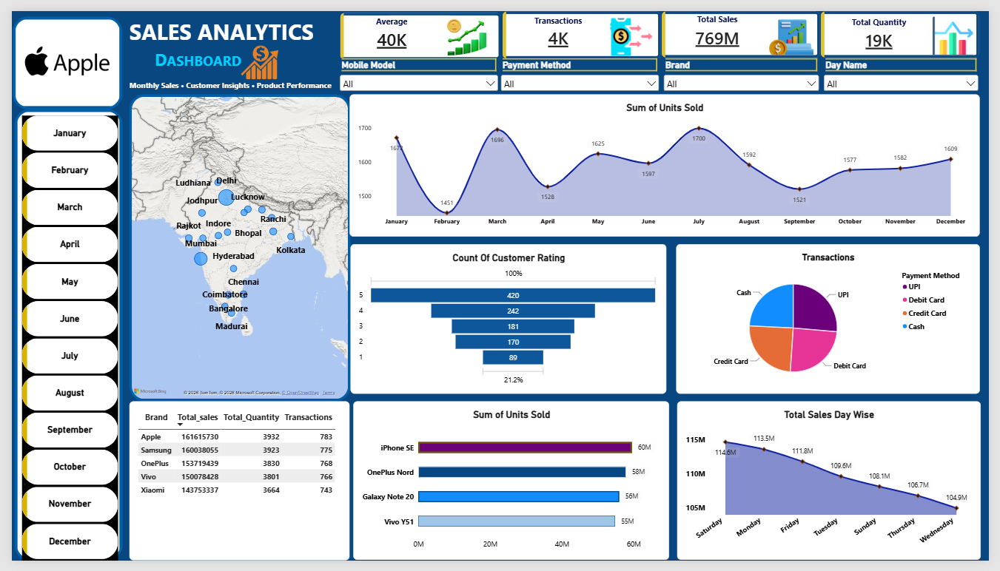

# 📱 Mobile Sales Analysis Dashboard

## 📌 Project Overview
This project analyzes mobile phone sales data using Microsoft Power BI. The interactive dashboard helps explore sales performance, customer ratings, payment preferences, product performance, and sales trends.

## 🛠️ Tools & Technologies
- **Power BI** — Dashboard development and visualization
- **Power Query** — Data cleaning and transformation
- **DAX** — Measures and calculations

## 📊 Key Features
- Monthly units sold analysis
- Brand-wise sales and transaction comparison
- Payment method analysis
- Customer rating distribution
- City-wise sales visualization
- Product model performance
- Day-wise sales trends
- Interactive filters and slicers

## 🧹 Data Preparation
The dataset was cleaned and transformed in Power Query before building the dashboard. DAX was used for calculations and measures.

## 🖼️ Dashboard Preview

## 📂 Project Files
- `Shrenikproject30.pbix` — Power BI report file
- `iphonesalesproject.png` — Dashboard screenshot

## 📚 Data Source
Dataset obtained from an online Coursera course and used for learning and portfolio development.

## 👨‍💻 Author
**Shrenik More**

GitHub: [shrenikmore](https://github.com/shrenikmore)
